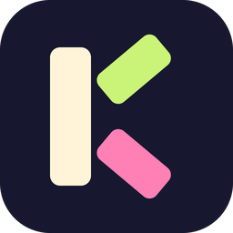
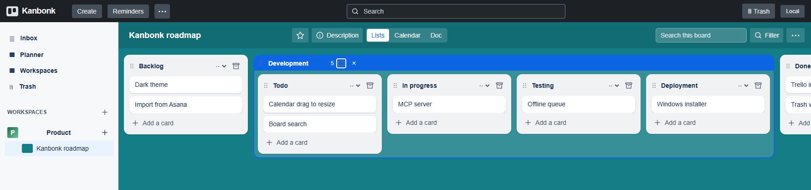

<div align="center">



# Kanbonk

Local-first Kanban boards for desktop, browser and mobile. No account, no cloud, no server.

[](LICENSE) [](./package.json) [](https://github.com/khasky/kanbonk/issues)   [](https://github.com/sponsors/khasky) [](https://emojery.app/react?t=github/khasky/kanbonk)

[Features](#features) · [Quick start](#quick-start) · [Platforms](#platforms) · [Privacy](#privacy-and-security) · [Documentation](#documentation) · [Project status](#project-status) · [Contributing](#contributing) · [Security](#security) · [Support](#support) · [License](#license)



<sub>Built with <b>React</b> · <b>TypeScript</b> · <b>Tauri</b></sub>

</div>

Kanbonk keeps every workspace, board, list, card and attachment on your own devices. Devices sync directly with each other over Wi-Fi, a private peer-to-peer link or an encrypted file you pass by Bluetooth, and existing boards come in from Trello JSON, ZIP and CSV exports.

## Features

**Boards**

- **Lists and cards** — drag lists left and right, drag cards within a list and between lists. A card opens over the board, or as its own page by link (`/c/<id>`).
- **Rich cards** — title, visual Markdown description and comments, start and due dates, checklists, labels in any color, members, attachments, covers, full-card colors and stickers.
- **Sub-cards, clone and share** — a clone lands right below the original as `<name> - Clone`; share a card as print, PNG, JSON, link or QR code.
- **Zones** — group adjacent lists into one zone, e.g. *Development* = Todo + In progress + Testing + Deployment. A list belongs to at most one zone.
- **Calendar** — week, month and year views. A card sits on its start date (or creation date) and stretches to its due date like an event; drag it between days, drag its edges to change dates, delete it with ×.
- **Dependencies** — a card can depend on another card on any board. Deleting a card warns about the cards that depend on it.
- **Instant search** — on the board and across all workspaces, with filters such as `board:`, `label:`, `due:overdue` and `has:attachments`.
- **Fast on big boards** — stays responsive with thousands of cards, on phones too. See the [load test results](docs/testing.md#performance).

**Your data stays yours**

- **Trash** — deleted workspaces, boards, lists and cards are kept for 30 days (adjustable in Settings). Restoring an item also restores the parents and dependencies it needs.
- **Automatic backups** — version snapshots every 10 minutes and a full ZIP with all files every 6 hours, day or week, written to Downloads, Documents or a folder you choose; the newest N are kept.
- **Duplicate finder** — finds similar cards across boards entirely on the device and merges them in one click.
- **History** — full revision history for every workspace, board, list and card.

**Board + document, AI and agents**

- **Project document** — every board has a document with links to cards, backlinks and a live project summary, so the context lives next to the work.
- **AI assistant with your own key** — Claude, ChatGPT, Gemini or any OpenAI-compatible server. It turns emails and meeting notes into cards that quote their source and writes the project document citing cards. Nothing is sent without a click.
- **MCP server** — AI agents read and change boards through a headless Kanbonk device that syncs with your devices after you trust it.

**Sync without a cloud**

- **Instant and offline** — every change is saved locally at once; offline changes queue up and are sent when the connection returns. Tabs of the same browser stay in sync automatically.
- **Wi-Fi** — devices meet in a room on a small local relay (`pnpm serve:lan`) that only sees encrypted packets.
- **Peer-to-peer over the internet** — a direct, DTLS-encrypted WebRTC link set up by exchanging an invitation, e.g. through a messenger.
- **Bluetooth, USB or messenger** — an encrypted `.kanbonk-sync` file with data and attachments.
- **Trusted devices** — a new device must be approved before any data is accepted. Concurrent edits are detected and you choose which version to keep.

**Import and export**

- **Import** — Trello JSON exports, ZIP archives with attachments and Trello CSV.
- **Export** — any board as Trello-shaped JSON or as CSV with the same columns.

The [feature guide](docs/features.md) covers every page and setting.

## Quick start

Requires [Node.js](https://nodejs.org/) 22.12 or newer and [pnpm](https://pnpm.io/).

```sh
git clone https://github.com/khasky/kanbonk.git
cd kanbonk
pnpm install
pnpm dev
```

Open the address Vite prints (by default `http://localhost:1420`). Data is stored in the browser's IndexedDB on this device.

Run the tests and a production build:

```sh
pnpm test
pnpm build
```

To use Kanbonk from a phone on the same Wi-Fi, build and start the LAN server with your computer's local IP, then open `http://<ip>:4174` on the phone:

```sh
pnpm build
pnpm serve:lan 192.168.1.10 4174
```

## Platforms

One React app in `src/` runs everywhere; the platform-specific code lives in a single module, [`src/lib/platform.ts`](src/lib/platform.ts).

| Platform | Develop | Build | Output |
| --- | --- | --- | --- |
| Web | `pnpm dev` | `pnpm build` | `dist/` |
| Chrome / Edge extension | `pnpm dev:extension` | `pnpm build:extension` | `dist-extension/` (load unpacked) |
| Windows (Tauri) | `pnpm tauri dev` | `pnpm tauri build` | NSIS `.exe` and `.msi` in `src-tauri/target/release/bundle/` |
| Android (Tauri) | `pnpm tauri android dev` | `pnpm tauri android build -- --apk` | APK in `src-tauri/gen/android/app/build/outputs/apk/` |
| macOS, Linux, iOS (Tauri) | `pnpm tauri dev` / `pnpm tauri ios dev` | `pnpm tauri build` / `pnpm tauri ios build` | not built or tested yet |

Native builds need the [Tauri prerequisites](https://v2.tauri.app/start/prerequisites/): Rust for desktop, plus JDK 17, the Android SDK and NDK for Android. Step-by-step setup is in [docs/platforms.md](docs/platforms.md).

## Privacy and security

- **No account, telemetry or Kanbonk server.** Each device keeps its data locally, in IndexedDB in browsers and in the app WebViews.
- **Encrypted Wi-Fi sync.** Packets are encrypted end to end with XChaCha20-Poly1305 under a key derived from a 128-bit pairing code. The relay forwards ciphertext and never stores data.
- **Encrypted peer-to-peer sync.** WebRTC data channels use DTLS. Public STUN servers learn only network addresses.
- **Encrypted file bundles.** A sync file is encrypted with the pairing code of a trusted device.
- **AI only on request.** The assistant is off until you add your own key. The key stays on the device, and board data goes straight to the chosen provider only when you press an AI action (see [docs/ai.md](docs/ai.md#privacy)).
- **Trusted networks only for the LAN server.** It serves the app over plain HTTP, so anyone on that network could tamper with the page before encryption starts.

The design and its limits are described in [docs/sync.md](docs/sync.md).

## Documentation

| Document | Contents |
| --- | --- |
| [Feature guide](docs/features.md) | Pages, cards, zones, calendar, search syntax, automation, reminders |
| [Architecture](docs/architecture.md) | Code layout, state flow, routing, platform layer |
| [Data model](docs/data-model.md) | Entities, IDs, revisions, soft delete, tombstones |
| [Sync](docs/sync.md) | Transports, encryption, trusted devices, merge and conflicts |
| [Trash and dependencies](docs/trash-and-dependencies.md) | Delete, restore chains, 30-day purge, card dependencies |
| [AI and the board document](docs/ai.md) | Project document, AI providers, privacy, inbox triage, citations |
| [MCP server](docs/mcp.md) | Connecting AI agents, tools, security |
| [Backups](docs/backups.md) | Automatic snapshots, scheduled full backups, ZIP backup format |
| [Trello import and export](docs/trello.md) | JSON, ZIP and CSV formats, the Trello import extension |
| [Platforms](docs/platforms.md) | Building and developing for web, extension, Windows, Android |
| [Testing](docs/testing.md) | Automated tests, what has been verified, manual device checklist |

## Project status

Kanbonk is **alpha** software. The web app, the Windows build, the Chrome/Edge extension and the Android build in an emulator have been tested. Sync between physical phones, Bluetooth transfer, peer-to-peer across different networks and iOS builds have not been verified yet. The full list is in [docs/testing.md](docs/testing.md).

## Contributing

Bug reports, ideas and pull requests are welcome. See [CONTRIBUTING.md](./CONTRIBUTING.md) for branch naming, commit conventions and checks. Taking part is covered by the [Code of Conduct](./CODE_OF_CONDUCT.md).

## Security

Found a vulnerability? Don't open a public issue — report it privately, see [SECURITY.md](./SECURITY.md).

## Support

If **Kanbonk** is useful to you, you can support development:

- [GitHub Sponsors](https://github.com/sponsors/khasky)
- [Patreon](https://www.patreon.com/khasky)
- [Ko-Fi](https://ko-fi.com/khasky)

## License

This project is licensed under the MIT License. See the [LICENSE](./LICENSE) file for details.
